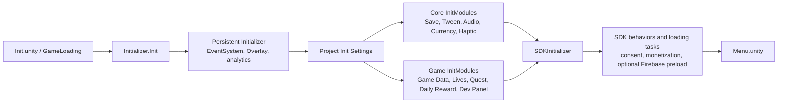
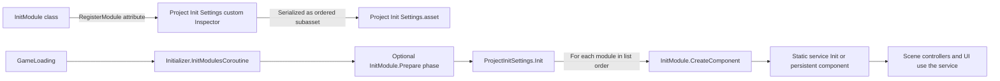
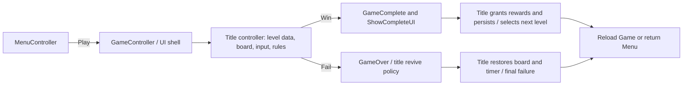

# GameFrameWorkPackage

GameFrameWorkPackage is a reusable Unity mobile-game framework for casual, puzzle, idle, merge, tap/drag, and hyper-casual projects. Shared services live in `NebulaSoft Core`; each title adds its own gameplay rules, content, UI, and scenes under `Project Files` without changing the framework layer.

This repository currently targets **Unity 6000.6.8f1** and framework version **1.4.0**. Its enabled build scenes are:

1. `Assets/Project Files/Game/Scenes/Init.unity`
2. `Assets/Project Files/Game/Scenes/Menu.unity`
3. `Assets/Project Files/Game/Scenes/Game.unity`

> The bundled reference game demonstrates one integration of the framework. Reuse the core services and add a focused game module for each new title; it is not necessary to retain the reference game's rules or content.

The current template contains the application/UI shell and reusable services. Its `LevelData` is a lightweight session contract and its power-up bar is UI-only; a new game supplies its own board, input, level database and mechanics. See the Vietnamese [developer guide](docs/framework-developer-guide.md) and [PDF](output/pdf/GameFrameWorkPackage_Developer_Guide_MVC.pdf) for step-by-step onboarding, Astah-style UML diagrams, Init/Menu/Game hierarchies and flows, controller/UI/save interactions, model restoration, UI change events, module configuration and C# examples checked against the current source. Chapter 6 distinguishes scene controllers, UI routing, feature state and persistence; it also documents the current win/NEXT behavior and disabled periodic autosave.

## Quick start

Use the Vietnamese [module implementation handbook](docs/modules/README.md) to look up each module's source, Unity setup, gameplay API and integration checks.

1. Clone the repository and open it in Unity Hub with Unity **6000.6.8f1**.
2. Let Unity resolve the dependencies declared in `Packages/manifest.json`.
3. Open `Assets/Project Files/Game/Scenes/Init.unity` and press Play. `Init` is the bootstrap scene; do not start a normal play session from `Menu` or `Game` unless the initializer has already run.
4. Use the EditMode tests in `Assets/Tests/Editor` from **Window → General → Test Runner** to validate the local setup.

### Optional service integrations

Firebase, Facebook login, advertising, and in-app purchases are optional product integrations. Before shipping a new game, configure the corresponding provider accounts, platform identifiers, consent flow, store products, and platform configuration files for *your own* application. Do not commit credentials, signing keys, API secrets, or production configuration copied from another app.

Firebase-dependent code is conditionally compiled with `FIREBASE`; Facebook support is guarded by `FACEBOOK`. The monetization layer also uses feature symbols such as `MODULE_IAP`, `MODULE_ADMOB`, `MODULE_ADSKIT`, and `UNITY_IAP_NEW`. A feature should be enabled only after its package and platform setup are complete.

The [Analytics module](docs/analytics-module.md) is registered in Project Init Settings with a Console provider for the template. It supplies casual/puzzle events, startup buffering, level-attempt tracking and Ads/IAP/UI integrations. Its optional Firebase adapter uses the separate `FIREBASE_ANALYTICS` symbol after importing the Analytics SDK; the core runs without Firebase.

## Project layout

```text
.
├── Assets/
│   ├── NebulaSoft Core/
│   │   ├── Foundation/         # Small shared contracts
│   │   ├── Modules/            # Reusable services, Runtime/Editor per module
│   │   ├── Features/           # Optional Quest, DailyReward, Lives logic
│   │   ├── Integration/        # Composition and tools spanning assemblies
│   │   ├── Utilities/          # Shared runtime/editor helpers
│   │   ├── Shared/             # Framework prefabs, animations, images
│   │   ├── Editor/             # Framework-wide editor tools
│   │   └── Examples/           # Small core examples
│   ├── Project Files/          # Reference-game and future-title data, gameplay, UI, art, and scenes
│   │   ├── Data/               # ScriptableObject databases and game configuration
│   │   └── Game/
│   │       ├── Scenes/         # Init, Menu, Game
│   │       ├── Scripts/        # Game bootstrap, controllers, session contracts
│   │       ├── Features/       # Title-owned feature scripts, prefabs, and art
│   │       ├── UI/             # Shared title UI, fonts, sprites, and popups
│   │       ├── Integration/    # Title-specific Firebase and Ads adapters
│   │       ├── Prefabs/        # Bootstrap, particles, and remaining game prefabs
│   │       └── Animations|Audio|Images|Models|Materials|Textures|Shaders/
│   ├── Addon/ThirdParty/       # UIEffect-5.9.6, vendor source kept intact
│   ├── GoogleMobileAds/        # Installed AdMob SDK and settings
│   ├── ExternalDependencyManager/ # Native dependency resolver
│   ├── Plugins/                # Native and third-party plugins
│   └── Tests/Editor/           # EditMode regression tests
├── Packages/                   # Unity Package Manager manifest and lock file
├── ProjectSettings/            # Unity project and build settings
├── tools/                      # ModuleAudit, PlayerCompileProbe, Documentation
├── docs/                       # Guides, diagrams, and historical audit evidence
└── output/                     # Exported documents and audit reports
```

See [folder ownership and migration map](docs/project-structure.md) before adding or moving a module. UI samples previously in `Assets/Addon/UI` now belong to `Project Files/Game/Features` or `Project Files/Game/UI`. Framework assets previously in `Assets/Framework` now live in `NebulaSoft Core/Shared`. Keep `.meta` files with moved assets.

### Ownership boundaries

| Area | Owns | Change here when |
| --- | --- | --- |
| `Assets/NebulaSoft Core` | Generic initialization, persistence, UI, economy, monetization, tweening, and utilities | Improving a reusable capability without coupling it to a particular game's rules |
| `Assets/Project Files` | Reference-game content plus title-specific game flow, rules, presentation, and services | Adding or changing gameplay, content, UI, balancing, or progression for a title |
| SDK/vendor folders | Imported provider SDKs and third-party packages | Updating an integration according to the provider's migration guide; avoid direct feature edits |
| `Packages` and `ProjectSettings` | Dependency versions, editor/build/platform configuration | Upgrading Unity/packages or configuring a new app target |

Do not place new gameplay rules in imported SDK folders or modify third-party source to implement product features.

## Application lifecycle

### Bootstrap

`Init.unity` owns the persistent initialization sequence. `GameLoading` calls `Initializer.Init()`, then initializes registered modules and SDK behaviors/tasks. `Initializer` is kept alive across scene loads, binds the overlay and event system, initializes analytics/static modules, and then delegates to `ProjectInitSettings` and `SDKInitializer`.



`Project Init Settings.asset` contains the registered `InitModule` instances. Each module derives from `InitModule` and creates or initializes one service. Modules should be independent of a particular level or scene whenever possible.

### Module registration and service initialization


The Inspector above is the project's service registry. It serializes an ordered `InitModule[]` inside `Project Init Settings.asset`; it is **not** a dependency-injection container. A module owns its serialized configuration, and its `CreateComponent()` method initializes the corresponding static manager/service or persistent runtime component.



At editor time, `[RegisterModule("Name", core, order)]` makes an `InitModule` discoverable by the custom `Project Init Settings` inspector. Modules marked `core: true` are required when a settings asset is created; their `order` determines creation priority. Non-core modules are optional entries added from the Inspector's **Add Module** menu, with one instance of each module type per settings asset.

At runtime, `GameLoading` initializes the bootstrap, runs the configured connectivity check, and waits for optional `InitModule.Prepare()` work. `ProjectInitSettings.Init()` then invokes `CreateComponent()` on each module in list order. Static modules, global music, SDK behaviors and loading tasks initialize before the next scene loads.

The modules shown in the screenshot currently register services as follows:

| Inspector module | Serialized configuration | Runtime registration/effect |
| --- | --- | --- |
| **Remote Config** | Direct HTTPS endpoint, timeout and optional bundled JSON | Loads a startup snapshot during `Prepare()` so other modules can read overrides |
| **Save Controller** | Autosave delay, clear-on-start option, WebGL key prefix | Calls `SaveController.Init(...)`; this must precede services that load player state |
| **Tween** | Custom easing functions and update-pool capacities | Adds the persistent `Tween` component to `Initializer.GameObject`, initializes it, then registers easing functions |
| **Audio Controller** | Audio clip library, pool size, and 3D audio defaults | Applies 3D settings and calls `AudioController.Init(...)` |
| **Currencies** | `CurrencyDatabase` | Calls `CurrencyController.Init(database)` for balances, currency definitions, and reward integration |
| **Haptic** | Optional verbose logging | Enables logging when requested, then calls `Haptic.Init()` to select the platform wrapper |
| **Dev Panel** | `DevPanelSettings` | Validates settings and links them through `DevPanelEnabler.LinkSettings(...)` |
| **Game Settings** | `GameData` | Calls `GameData.Init()`, exposes global defaults, and applies relevant remote-config overrides |
| **Lives System** | `LivesData` | Validates data and calls `LivesSystem.Init(data)`; it reads persisted life state from the save service |
| **Screen Settings** | Target frame rate and sleep-timeout options | Applies `Application.targetFrameRate` and `Screen.sleepTimeout` |
| **Quest** | `QuestDatabase` | Calls `QuestService.Init(database)` |
| **Daily Reward** | `DailyRewardDatabase` | Calls `DailyRewardService.Init(database)` after the save service is ready |

To add a framework or game service, create a `ScriptableObject` derived from `InitModule`, add `[RegisterModule("Feature Name", core: false)]`, serialize its settings, and call the service's initialization method from `CreateComponent()`. Add the module in `Project Init Settings.asset`, place it after every dependency it requires, and add an EditMode test for initialization and save/remote-config edge cases. Use `core: true` only when every project created from the framework requires the module.

### Menu-to-game runtime flow

`MenuController` initializes menu pages, preloads the local leaderboard and loads `Game.unity` on Play. Its current Play callback does not validate/lock a life. `GameController` initializes game pages and exposes activation, complete, fail, revive and scene navigation hooks. The new game's controller must build its board, handle input/rules and call those hooks; the template has no runtime `LevelController` or `RaycastController`.



## Reusable core modules

The core is organized under `Assets/NebulaSoft Core/Modules`. The table describes responsibility and the normal integration boundary; it does not require every feature to be active in every build.

| Module | Responsibility | Primary entry/configuration | Boundary |
| --- | --- | --- | --- |
| **Initializer** | Persistent bootstrap, registered modules, loading tasks, consent and SDK behavior orchestration | `Initializer`, `GameLoading`, `Project Init Settings.asset`, `SDKInitializer` | Starts services; should not contain title-specific rules |
| **Save** | Local save-object creation, serialization, autosave, global and named saves | `SaveInitModule`, `SaveController`, `SavePresets` | Feature services own their save models; this module owns storage lifecycle |
| **UI** | Page/popup navigation, overlay, safe area, button audio/haptics feedback | `UIController`, `UIPage`, popup interfaces | UI pages display state; game rules remain in controllers/services |
| **Tween** | Time-based animations, callbacks, coroutines, reusable tween behaviors | `TweenInitModule`, `Tween`, `TweenCase` | Presentation/timing helper; it must not become gameplay state storage |
| **Audio** | Audio clips, music sources, sound playback, audio save state | `AudioInitModule`, `AudioController`, `MusicSource` | Central playback service; content references belong to game assets |
| **Currency** | Currency definitions, balances, remote overrides, rewards and UI views | `CurrencyInitModule`, `CurrencyController`, `CurrencyDatabase` | General economy primitives; game features request grants/spends through it |
| **Reward** | Extensible reward definitions, holders, previews and application helpers | `Reward`, `RewardsHolder`, registration attributes | Compose rewards for game features without hard-coding UI or store logic |
| **Monetization** | Ads, rewarded ads, IAP products, entitlement state, privacy/consent integration | `MonetizationSettings`, `AdsManager`, `IAPManager` | Provider adapters are isolated behind framework managers and compile symbols |
| **Haptic** | Cross-platform haptic patterns, settings, priority and native wrappers | `HapticInitModule`, `Haptic` | Gameplay/UI choose feedback intent; platform wrappers implement it |
| **Pool** | Reusable object pools and scene holders | `PoolManager`, `Pool`, `PoolGeneric` | Owns object reuse, not game-object behavior rules |
| **Analytics** | Analytics module registration and event dispatch integration | `AnalyticsModules`, `AnalyticsController` | Provider/event plumbing; event semantics are defined by the game feature |
| **Defines** | Attributes and tooling for conditional compile definitions | `DefineAttribute` and project symbols | Controls feature compilation; not a runtime dependency container |
| **Skins** | Shared skin-selection extension point used by game data | `SkinController` and game-specific skin databases | The template's concrete level skins live under `Project Files/Data/Skins` |
| **Inspector** | Custom inspector styles and editor presentation support | Core inspector assemblies/settings | Editor-only tooling; no runtime gameplay dependency |

## IAP module

IAP can be configured through **Project Init Settings → Monetization/IAP** with a standalone **IAP Settings** asset. Add products using stable string keys and select them on the existing **IAPRewardsHolder** prefab component; new products do not require editing an enum. See [IAP module setup and migration](docs/iap-module.md).

## Ads module

Configure **Project Init Settings → Monetization/Ads** using **AdsModuleSettings**, an **AdsCatalog**, placement assets and a provider configuration. Gameplay uses `IAdsService`; SDK translation, existing No Ads save state and game UI each have their own boundary. Ads Kit 2.3.0 with AdMob 11.0.0 is installed and configured with test IDs; Dummy remains available as another provider. See [Ads module setup and migration](docs/ads-module.md).

## Reference-game modules

The current reference game is under `Assets/Project Files/Game`. `Scripts` owns bootstrap/controllers, `Features` owns title-specific feature presentation, `UI` owns shared title UI, and `Integration` owns title-specific service adapters. A new game can replace or extend this layer without changing `NebulaSoft Core`.

| Group | Main types and assets | How it works |
| --- | --- | --- |
| **Game flow and session** | `GameInitModule`, `GameData`, `GameController`, `MenuController`, `ActiveSession`, `CameraController` | Loads global game settings, holds the selected/displayed level state, switches Menu/Game scenes, and orchestrates win, fail, revive, ads, and completion UI |
| **Level/session contract** | `LevelData`, `LevelSave`, `ActiveSession`, `GameplayTimer`, `WinStreakProgress` | Preserves session/progress APIs and a timer. `LevelData` has no board schema; title code supplies its database, board, input and rules |
| **Power-up presentation** | `PUUIController`, `PUUIBehavior`, `PUSave` | UI-only preview bar and save contract. Inventory grants, eligibility and board mechanics require a title implementation |
| **Lives** | `LivesSystem`, `LivesData`, `LivesSave`, `UIAddLivesPanel` | Persists lives, restores them over time and supports infinite-life rewards. Title flow chooses lock/unlock and final-failure policy |
| **Quest and Daily Reward** | `QuestService`/`QuestDatabase`; `DailyRewardService`/`DailyRewardDatabase` | Initializes data-driven progression rewards; daily rewards enforce one claim per UTC day and reset the sequence after missed days |
| **Store and No Ads** | `UIStore`, store elements, `UINoAdsOffer`, IAP reward assets | Presents currencies/offers and integrates with the core monetization/reward systems |
| **Remote Config** | `RemoteConfigInitModule`, `RemoteConfigController` | Fetches and caches an optional startup snapshot. Consumers read typed overrides with their own fallback defaults |
| **Firebase and profile** | Firebase handlers, profile UI, cloud sync, leaderboard, soft update | Optional cloud identity/progress, no-ads entitlement synchronization, leaderboards, and update checks; compiled safely out when `FIREBASE` is absent |
| **Presentation and retention UI** | `UI`, `Settings`, `Tutorial`, `Feature Announcement`, `Level Map` | Renders pages/popups/HUD, settings, guided onboarding, unlock announcements, and level-map elements |
| **Developer tooling** | `Dev Panel`, core editor tooling, `Assets/Tests/Editor` | Provides developer controls and EditMode coverage; board authoring belongs to the new title |

## Data, persistence, and configuration

Native saves now use a versioned JSON envelope with legacy loading, per-model migrations and backup recovery. Add `[SaveModel("stable.id", version, CloudSync = true)]` to register new state with the existing cloud progress flow. See [save versioning and migration](docs/save-module.md). Retention runtime features are in `Assets/NebulaSoft Core/Features`; their views and gameplay adapters remain title-owned.

### Data flow

Most content follows this path:

```text
ScriptableObject database / settings asset
    → InitModule or scene controller
    → Runtime service or behavior
    → SaveController-backed save object (when state must persist)
    → UI / gameplay result
```

Examples include retention/economy data through lives, quest, daily-reward, reward and currency databases. New titles add their own level and power-up definitions. Keep designer-editable defaults in ScriptableObjects and player-specific state in save models.

The optional Remote Config module ships in Project Init Settings with a bundled casual puzzle profile. Set a direct HTTPS URL when you have a remote source. Features read structured overrides with `TryGetConfig<T>()` or scalar flags with `TryGetValue<T>()`. [Remote Config setup and fallback behavior](docs/framework-developer-guide.md#24-remote-config-profile-và-leaderboard)

Firebase is not required for local play. With `FIREBASE` enabled, the Firebase module can authenticate a player, synchronize selected progress/profile data, maintain no-ads entitlement, preload/submit leaderboards, and check soft updates. Local save remains the base progression store.

### Important configuration assets

| Concern | Main location | Use it to |
| --- | --- | --- |
| Startup modules | `Assets/Project Files/Data/Project Init Settings.asset` | Enable/configure `InitModule` instances and their initialization data |
| Game-wide settings | `Assets/Project Files/Data/Game Data.asset` | Set reward, revive and ad threshold defaults |
| Levels and power-ups for a new title | Title-owned data folders | Add a gameplay database/schema and mechanic configuration; the template contracts do not contain a board engine |
| Progression | `Assets/Project Files/Data/Lives Data.asset`, `Data/Quest/`, `Data/Daily Reward/` | Configure lives, quests, and the seven-day daily-reward schedule |
| Monetization and rewards | `Assets/Project Files/Data/Monetization Settings.asset`, `Data/Rewards/` | Configure monetization/reward definitions after provider setup |
| Scenes and build | `ProjectSettings/EditorBuildSettings.asset` | Maintain scene order and enabled build scenes |
| Unity packages | `Packages/manifest.json` | Pin or upgrade Unity Package Manager dependencies |

## Extending the template

Use this pattern when building a new capability:

1. **Put game-specific code in `Assets/Project Files/Game`.** Create a focused service/controller and, where appropriate, a ScriptableObject database and serializable save model.
2. **Add an `InitModule` only for a global service.** Derive from `InitModule`, initialize the service in `CreateComponent()`, then add/configure its asset through `Project Init Settings.asset`. Ensure dependencies such as Save are initialized before the feature needs them.
3. **Keep scene behavior thin.** Scene controllers should assemble scene components and invoke services; reusable behavior should not depend on a particular puzzle scene.
4. **Register UI and scene dependencies deliberately.** Add the necessary prefabs/pages/controllers to the owning scene and initialize them from the existing `UIController`/scene flow rather than relying on arbitrary global lookups.
5. **Use extension points for common systems.** Compose existing reward, save, UI and monetization APIs; add title-owned board/power-up contracts rather than editing vendor source or assuming a gameplay registry exists.
6. **Add an EditMode test for deterministic logic.** Keep behavior-specific tests in `Assets/Tests/Editor` and test persistence, remote-data parsing, and edge cases separately from visual/manual QA.

## Tests and validation

Current EditMode tests cover areas including coin-safe progress, Firebase progress/name registry behavior, network connection behavior, quest rotation, and the IAP module. Run them in Unity Test Runner after changing framework logic or configuration that affects those systems.

Before publishing changes, verify:

- `README.md` paths point to assets that exist in this repository.
- The three build scenes still match `ProjectSettings/EditorBuildSettings.asset`.
- Optional SDK documentation does not imply a provider is mandatory.
- No provider credentials, signing files, secrets, or customer-specific identifiers were added.
- New game features do not require direct edits to imported SDK/vendor source.

## License

Project-owned source files in this repository are licensed under the [Apache License 2.0](LICENSE). Third-party SDKs, plugins, fonts, and assets remain subject to the license notices included with those dependencies; the Apache License does not replace their terms.
