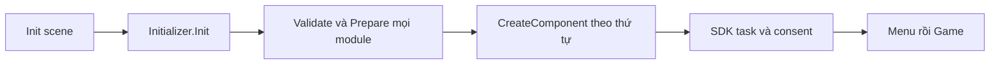

# Khởi tạo và cấu hình dự án

[Sổ tay module](README.md)

## Initializer

`GameLoading` điều phối màn hình loading. `Initializer` tạo ngữ cảnh sống qua scene, gồm EventSystem, overlay và module. `ProjectInitSettings` chứa danh sách `InitModule` theo thứ tự chạy. `SDKInitializer` gắn các `SDKBehavior` và `ISDKTaskBehavior` của prefab SDK vào bước startup. [Source Initializer](../../Assets/NebulaSoft%20Core/Modules/Initializer/Runtime)



1. Mở `Project Init Settings.asset` và thêm module qua Inspector. `RegisterModule` cung cấp tên menu và thứ tự gợi ý. Thứ tự thực tế do danh sách trong asset quyết định.
2. Với module mới, kế thừa `InitModule`, khai báo dependency, validate các reference trong `ValidateConfiguration` và gọi service ở `CreateComponent`.
3. Dùng `Prepare()` cho bước chuẩn bị như lấy config. Toàn bộ `Prepare` chạy trước `CreateComponent`, nên gọi Save/Currency ở bước khởi tạo sau khi dependency đã chạy.
4. Dọn event, coroutine hoặc SDK resource trong `Shutdown`. Giữ bước khởi tạo có thể gọi lại khi lần trước thất bại. Các module đã khởi tạo được shutdown theo thứ tự ngược.

Mẫu module game lấy model save khi bootstrap chạy. Tạo file `RunProgressInitModule.cs` trong `Game/Scripts` và thêm mục **Game/Run Progress** trong Inspector.

```csharp
using System;
using NebulaSoft;

[Serializable, SaveModel("game.run-progress")]
public sealed class RunProgressSave : ISaveObject
{
    public int completedRuns;
    public void Flush() { }
}

[RegisterModule("Game/Run Progress")]
public sealed class RunProgressInitModule : InitModule
{
    public override string ModuleName => "Run Progress";
    public override Type[] Dependencies => new[] { typeof(SaveInitModule) };

    public override void CreateComponent()
    {
        SaveController.GetSaveObject<RunProgressSave>();
    }
}
```

Asset mẫu đang chạy Remote Config, Save, Analytics, Tween, Audio, Currency, Haptic, Dev Panel, Game Settings, Lives, Screen Settings, Quest, Daily Reward, IAP và Ads theo thứ tự này. Các module đọc save khai báo hoặc cần được đặt sau Save. Lives còn dùng Currency và Tween. [Registry hiện tại](../../Assets/Project%20Files/Data/Project%20Init%20Settings.asset)

**Khi thêm SDK task.** Cài `ISDKTaskBehavior` để cung cấp một `LoadingTask`, gọi `CompleteTask` khi SDK trả kết quả và xử lý callback đến muộn. Mặc định task timeout sau 30 giây và `IsRequired` là false. Hiện `GameLoading` cho qua lỗi task tùy chọn, còn `SDKInitializer` bỏ qua lượt gọi `OnUserConsentReceived` khi có task lỗi hoặc timeout. Vì vậy cần kiểm tra riêng trường hợp vào Menu nhưng Ads/IAP chưa sẵn sàng. [LoadingTask](../../Assets/NebulaSoft%20Core/Modules/Initializer/Runtime/LoadingTask.cs) · [SDKInitializer](../../Assets/NebulaSoft%20Core/Modules/Initializer/Runtime/SDKInitializer.cs)

**Kiểm tra.** Chạy `Init → Menu → Game`. Thử bỏ một dependency trên bản sao registry, xác nhận lỗi hiển thị đúng. Kiểm tra duplicate module, task mất callback và việc gọi retry khi SDK không phản hồi.

## CoreSettings

`CoreSettings` là ScriptableObject chứa đường dẫn Data/Scenes, tên scene Init, cờ mở Init tự động và tùy chọn Inspector. `CoreEditor` đọc asset này cho các công cụ editor. [Runtime](../../Assets/NebulaSoft%20Core/Modules/CoreSettings/Runtime/CoreSettings.cs) · [Editor](../../Assets/NebulaSoft%20Core/Modules/CoreSettings/Editor/CoreEditor.cs)

1. Dùng asset Core Settings của template hoặc tạo qua **Create → Data → Core → Core Settings** khi dựng dự án mới.
2. Đặt `DataFolder`, `ScenesFolder` và `InitSceneName` theo dự án. Dùng **Window → NebulaSoft Core → Prepare Project** khi cần công cụ tạo cấu trúc, registry và Init mới.
3. Editor tool mới nên đọc đường dẫn từ `CoreEditor` thay vì tự ghép đường dẫn tới title mẫu.

**Kiểm tra.** Mở toolbar scene và Inspector sau khi đổi cấu hình. Xác nhận Init tự mở đúng theo tùy chọn và các asset Data được tìm trong thư mục mới. [CorePreparationTool](../../Assets/NebulaSoft%20Core/Editor/CorePreparationTool.cs)

## Defines

`DefineManager` và `DefineSettings` hỗ trợ các cờ biên dịch tùy chọn. `DefinePostprocessor` kiểm tra type/asset để đồng bộ các define tự động. [Source Defines](../../Assets/NebulaSoft%20Core/Modules/Defines)

1. Mở **Window → NebulaSoft Core → Define Manager** hoặc **Tools → Editor → Define Manager**.
2. Đối chiếu SDK đã cài và target hiện hành trước khi bật define tương ứng. Kiểm tra Android và iOS riêng khi cấu hình hai target.
3. Đặt mã gọi SDK tùy chọn sau define trong adapter. Gameplay gọi interface hoặc facade của framework. Khi bỏ SDK, kiểm tra nhánh fallback và các asset vẫn tham chiếu provider cũ.

**Kiểm tra.** Editor biên dịch với tổ hợp define của template và với adapter tùy chọn tắt. `FIREBASE` của Auth/Firestore và `FIREBASE_ANALYTICS` phục vụ hai phần tích hợp riêng. [Các cờ SDK](services.md#firebase-progress)

## Scenes

`SceneObject` là field serializable để chọn scene, lưu `Name` và `Path`. Drawer nằm trong Editor. `ISceneSavingCallback.OnSceneSaving` là hook editor để component cập nhật reference khi lưu scene hoặc chuẩn bị vào Play Mode. [Source Scenes](../../Assets/NebulaSoft%20Core/Modules/Scenes)

1. Khai báo `[SerializeField] private SceneObject destination;` trên component game và kéo Scene asset.
2. Thêm scene vào danh sách scene của build profile, rồi gọi `SceneManager.LoadSceneAsync(destination.Path)` từ controller. Kiểm tra path rỗng trước khi điều hướng.
3. Dùng `ISceneSavingCallback` khi cần tái tạo danh sách reference như `UIPage`. Đặt thay đổi gameplay và IO save ở service runtime.

**Kiểm tra.** Mở lại scene để xác nhận field được serialize. Kiểm tra transition bằng scene đã bật trong build profile và test `FrameworkSceneSmokeTests`. [SceneObject](../../Assets/NebulaSoft%20Core/Modules/Scenes/Runtime/SceneObject.cs)

## Screen

`ScreenSettings` là InitModule thiết lập frame rate và `Screen.sleepTimeout`. Có chế độ chọn theo refresh rate và các mức mặc định/battery save. [Source Screen](../../Assets/NebulaSoft%20Core/Modules/Screen/Runtime/ScreenSettings.cs)

1. Thêm **Screen Settings** trong registry. Chọn chế độ tự động hoặc FPS mục tiêu, rồi đặt sleep timeout cho title.
2. Đặt safe area và layout trong UI module. Tách cài đặt hình ảnh riêng của gameplay thành UI hoặc model của game.
3. Khi thêm tuỳ chọn FPS trong menu, để controller game áp dụng mức đã chọn và dùng Save nếu cần giữ lựa chọn qua lần mở app.

**Kiểm tra.** Xem FPS và hành vi sleep trên thiết bị có refresh rate khác nhau. Kiểm tra lại HUD và input khi resume.

## User

`User.LocalId` tạo ID cục bộ lưu PlayerPrefs. `User.GetId()` trả custom ID nếu đã gắn, nếu không dùng local ID. Hash và GUID từ hash dùng ở biên tích hợp cần định danh ổn định. [Source User](../../Assets/NebulaSoft%20Core/Modules/User/Runtime/User.cs)

1. Khi gameplay cần định danh cục bộ, đọc `User.LocalId`.
2. Adapter auth gọi `User.SetCustomId(authenticatedUid)` sau khi xác nhận phiên. Khi logout gọi `User.SetCustomId(null)`.
3. Profile adapter sở hữu thông tin đăng nhập và dữ liệu đồng bộ. Custom ID trong `User` là trạng thái runtime. Kiểm tra danh tính phiên trước khi áp callback async vào save.

**Kiểm tra.** Đăng nhập, đăng xuất, đổi tài khoản và mở lại app. Kiểm tra đúng ID được gửi qua adapter và ngữ cảnh tải dữ liệu được làm mới.

## Foundation

`IClock`, `SystemClock`, `SimpleCallback` và `StaticUnloadAttribute` là contract dùng chung của runtime. `StaticUnloader` trong Editor gọi hook tĩnh khi thoát Play Mode. `Shutdown` tại module vẫn là điểm dọn resource cho luồng runtime. [Foundation](../../Assets/NebulaSoft%20Core/Foundation/Runtime) · [StaticUnloader](../../Assets/NebulaSoft%20Core/Editor/StaticUnloader/StaticUnloader.cs)

Khi viết service theo ngày hoặc thời gian chờ, nhận `IClock` và dùng `SystemClock.Instance` ở composition. Test có thể cấp clock cố định, như Lives/Quest. Khi module giữ event hoặc coroutine, xác định nơi subscribe và nơi giải phóng trong cùng vòng đời sở hữu.
