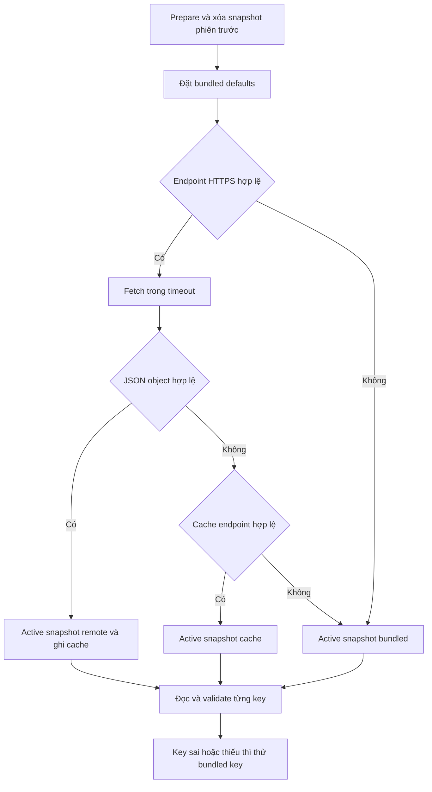

# Remote Config

Module đọc JSON từ HTTPS hoặc bundled asset, có cache theo endpoint và fallback theo key. `RemoteConfigInitModule` là điểm startup của composition hiện tại. [Runtime source](../Assets/NebulaSoft%20Core/Modules/RemoteConfig/Runtime) · [Sổ tay RemoteConfig](modules/data.md#remoteconfig)

## Cấu trúc và trách nhiệm

| Type | Trách nhiệm |
| --- | --- |
| `RemoteConfigInitModule` | Chuẩn bị defaults, fetch, cache và chọn snapshot cho startup |
| `RemoteConfigController` | Parse payload, giữ snapshot, đọc theo key và validate model |
| `RemoteConfigData` | Contract config typed với Key, PrettyPrint và Validate |
| `RemoteConfigHandler` | Điểm tích hợp MonoBehaviour cũ, caller chủ động chạy coroutine LoadConfig |
| `RemoteConfigDebugHandler` | Handler dùng chuỗi JSON trong Inspector cho luồng debug riêng |
| `RemoteConfigHandlerEditor` | Nút Copy Example JSON và renderer cho handler/init module |

Runtime sử dụng Newtonsoft.Json cho model config. Namespace hiện tại là `NebulaSoft`. Các class định nghĩa config riêng của game nằm trong `Game/Scripts/Remote Config`. Module HTTP hiện dùng UnityWebRequest và có thể thay nguồn fetch bằng subclass nếu game cần adapter khác.

## Cấu hình Inspector

1. Mở `Project Init Settings.asset` và thêm **Remote Config**.
2. Gắn **Local Config** là TextAsset JSON object. Template có `Remote Config Defaults.json` chứa key puzzle/revive của game mẫu.
3. Nhập **Endpoint** khi có URL trực tiếp tới JSON qua HTTPS. URL có credentials hoặc fragment bị từ chối. Redirect bị tắt.
4. Đặt **Timeout Seconds**, mặc định 3 và được clamp 1–15 khi fetch.
5. Dùng **Copy Example JSON** để tham khảo shape của các model hiện có. Nội dung xuất là ví dụ từ default constructor của các model, cần chọn key và kiểm tra tuning cho title trước khi publish.

`Prepare` của mọi InitModule chạy trước `CreateComponent` của các consumer. Vì vậy consumer lấy config trong CreateComponent hoặc lúc tạo session sau bootstrap. Chọn một Remote Config module làm owner cho snapshot của app.

## Thứ tự nguồn và fallback



Cache key có dạng `NebulaSoft.RemoteConfig.v1.<Hash128(URL)>` trong PlayerPrefs. Đổi URL tạo vùng cache khác. Lỗi fetch hoặc JSON mới sai giữ cache hợp lệ trước đó. Cache hiện lưu payload sau khi parse JSON object, còn validation nghiệp vụ diễn ra khi consumer đọc key.

Trong một lượt bootstrap mới, module bỏ active snapshot cũ trước khi chọn nguồn mới. Nếu endpoint và bundled đều trống, các override của phiên trước hết hiệu lực. `Shutdown` xóa cả active snapshot và bundled defaults. `RemoteConfigController.Init(json)` gọi độc lập sẽ giữ active snapshot hiện tại nếu JSON mới sai, để caller có thể từ chối một bản cập nhật hỏng.

## Schema cho game mới

Tạo file `BoardConfig.cs` trong thư mục Remote Config của game. Dùng field nullable khi cần phân biệt giá trị bị bỏ qua và giá trị 0 hợp lệ. Validate giới hạn và quan hệ giữa các field.

```csharp
using NebulaSoft;
using UnityEngine.Scripting;

[System.Serializable, Preserve]
public sealed class BoardConfig : RemoteConfigData
{
    public override string Key => "board";
    public int? moveLimit;
    public int? columns;

    public override bool Validate()
    {
        return (!moveLimit.HasValue || (moveLimit.Value >= 1 && moveLimit.Value <= 200))
            && (!columns.HasValue || (columns.Value >= 2 && columns.Value <= 12));
    }
}
```

Payload tương ứng.

```json
{
  "board": { "moveLimit": 30, "columns": 6 },
  "feature_new_menu": true
}
```

Consumer lấy config sau startup.

```csharp
var config = NebulaSoft.RemoteConfigController.TryGetConfig<BoardConfig>("board");
int moveLimit = config?.moveLimit ?? 30;
int columns = config?.columns ?? 6;

bool useNewMenu = NebulaSoft.RemoteConfigController.TryGetValue(
    "feature_new_menu", out bool enabled) && enabled;
```

Fallback áp dụng cho toàn bộ giá trị của một key. Remote `board` hợp lệ nhưng thiếu `columns` sẽ dùng default tại consumer hoặc initializer trong model, không ghép field `columns` từ bundled `board`. Nếu cần cả block có đủ field, đánh dấu required/validate field tương ứng để block thiếu bị từ chối. Cách này cho phép mỗi feature xác định rõ field tùy chọn và field bắt buộc.

`Key` và `PrettyPrint` được bỏ qua khi serialize. Lookup phân biệt hoa/thường theo key caller truyền. Parser giới hạn 256 KiB UTF-8, độ sâu 32, từ chối duplicate property, JSON root khác object và nhiều JSON nối tiếp. Download giới hạn byte nhận, chỉ nhận HTTP 2xx và decode UTF-8 hợp lệ. TypeNameHandling.None giữ payload theo model do client chọn.

## Currency config

Schema legacy của currencies dùng mảng object một cặp ID/số dư trong mỗi phần tử.

```json
{
  "currencies": {
    "defaultCount": [
      { "Coins": 100 },
      { "Gem": 5 }
    ]
  }
}
```

Mỗi ID phải khác rỗng và duy nhất, số dư là integer 32 bit không âm. Danh sách rỗng, ID trùng, số âm hoặc object chứa nhiều currency bị từ chối để controller thử bundled key. Remote default chỉ dùng để thiết lập currency chưa có số dư trong save. Số dư người chơi đã có được đọc từ Save.

## Chọn thời điểm áp config

1. Đọc tuning của ván khi tạo session và giữ snapshot cho ván đó.
2. Khi cần hot refresh, owner tải lại rồi gọi Init với payload hợp lệ. API hiện tại thay snapshot và consumer đọc lần kế tiếp sẽ lấy object mới.
3. Các service đã init như Currency/Lives thường giữ dữ liệu đã đọc. Game phải xác định mốc rebind thích hợp nếu muốn áp tuning mới.
4. Các thao tác thay model save, giá trị đã cấp hoặc định danh item cần migration riêng. Config tuning dùng chung với dữ liệu save qua ID ổn định.

Module chưa có lịch fetch định kỳ, event cập nhật hoặc TTL cache. Lần khởi tạo có endpoint hợp lệ luôn thử fetch trước cache. Nếu consumer cần rollout theo phiên bản ứng dụng, thêm field schema/cohort của game và validate ở consumer hoặc adapter.

## Thêm nguồn fetch

Kế thừa `RemoteConfigInitModule` và override `Fetch(Uri, Action<string>)` để nối transport của game. Chỉ gọi onSuccess với payload hoàn chỉnh, giữ timeout/cancellation ở transport đó, và để flow Prepare quản lý parse/cache/fallback. Khi dùng SDK có callback đến muộn, adapter phải ngăn callback của lượt cũ áp vào snapshot của lượt mới.

Nếu dùng `RemoteConfigHandler` kiểu cũ, caller chạy `LoadConfig(callback)` và implementation tự gọi `RemoteConfigController.Init` trong `OnConfigLoaded`. Handler này có timeout riêng 20 giây. Chọn một flow làm owner cập nhật config để tránh các nguồn cùng ghi snapshot.

## Kiểm tra và xử lý lỗi

| Tình huống | Kết quả cần có |
| --- | --- |
| Offline, có cache endpoint | Consumer đọc snapshot cache |
| Offline, chưa có cache | Consumer đọc bundled hoặc default của game |
| Remote JSON hỏng | Giữ cache trước đó và không ghi payload lỗi vào cache |
| Một key hỏng, key khác hợp lệ | Key hỏng thử bundled, key còn lại dùng override |
| Override currencies sai | Warning và fallback của currencies |
| Đổi endpoint | Cache cũ không được lấy cho URL mới |
| Chuẩn bị lại không có nguồn | Dữ liệu phiên trước được xóa |
| Consumer mutate object đã đọc | Lần lookup kế tiếp deserialize lại từ snapshot gốc |
| Config IL2CPP không được deserialize | Kiểm tra Preserve/linker cùng model được dùng trong player |

Chạy `RemoteConfigModuleTests` trong Editor. Test fetch dùng subclass fake và URL test riêng để kiểm tra deterministic cache/fallback. Kiểm thử HTTPS thật trên thiết bị xác nhận mạng, timeout và platform configuration của title. [Tests](../Assets/Tests/Editor/RemoteConfigModuleTests.cs) · [Init module](../Assets/NebulaSoft%20Core/Modules/RemoteConfig/Runtime/RemoteConfigInitModule.cs)

Đợt kiểm tra ngày 2026-11-07 đạt 212/212 EditMode test toàn dự án và 10/10 assertion ModuleAudit. Ca bổ sung kiểm tra reset snapshot khi Prepare không có nguồn, shutdown xóa bundled/active và sáu shape currency config không hợp lệ. Các ví dụ JSON được parse, ví dụ C# được biên dịch cùng các assembly dự án.
